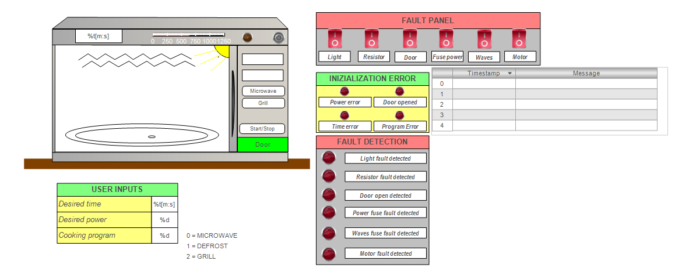
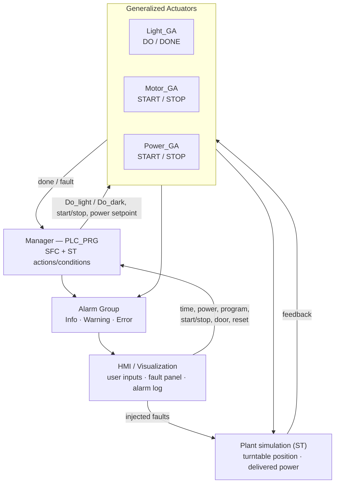

# PLC-Controlled Microwave Oven (CODESYS, IEC 61131-3)

A domestic microwave oven controller written in **CODESYS V3.5**. It has three cooking programs (Microwave, Defrost, Grill), power control, a cooking timer, a full **alarm management system** and a **fault-injection HMI**. The plant is simulated in software, so the whole machine can be tested without hardware.

> Project for **Control System Technologies** (2025)
> by Giorgio Giaretta, **Tommaso Magelli** and Alam Mehrub Mahbub.
> Project paper (Italian): [`docs/Microwave_paper_IT.pdf`](docs/Microwave_paper_IT.pdf)



## Highlights

- **Three IEC 61131-3 languages**: the manager logic in **SFC**, step actions and transition conditions in **ST**, and supporting logic in **FBD**.
- **Generalized Actuators (GA)** in a parent/child pattern: the manager never drives outputs directly, it sends commands to self-contained actuator blocks.
- **Alarm management** with 11 alarms in three classes, separate priorities and acknowledgement policies, and a timestamped alarm log.
- **Fault injection**: HMI switches simulate failures of the light, heating resistor, door, power fuse, wave generator and turntable motor.
- **Pause and resume**: the remaining cooking time is buffered when the cycle is paused or the door opens.
- **Mutual-exclusion reset** that safely clears settings and actuator commands in any state.

## Software architecture



| Component | Role |
|---|---|
| **Manager (`PLC_PRG`)** | SFC state machine with nested ST actions and conditions. It handles program selection, the timer, start/stop, the door interlock and reset |
| **Light_GA** | DO/DONE actuator. The light is on while cooking and when the door is opened at the end of a cycle. It has a dedicated FAULT step |
| **Motor_GA** | START/STOP actuator for the turntable. It stops on start/stop, door opening, a motor fault or cancel, and the remaining time is buffered |
| **Power_GA** | START/STOP actuator for the delivered power. The setpoint comes from the keypad or from the selected program, and it drops to zero immediately on a fuse fault |
| **Simulation** | ST code that emulates the physical microwave: turntable position and the actual delivered power |
| **Visualization** | HMI with power bar, mode indicators, m:s timer, door button, keypad and fault and alarm panels |

## Alarm management

| Class | Priority | Ack | Alarms |
|---|---|---|---|
| **Info** | 100 | REP | Selected cooking program |
| **Warning** | 30 | REP | Program out of range (0–2), door open, power below 200 W |
| **Error** | 10 | REP, acknowledge separately | Light, resistor, power fuse, waves fuse, motor failure |

Error-class alarms can only be raised from the fault panel, which reproduces how a real appliance would react to a component failure.

## How to run

1. Install **CODESYS V3.5** (free download from the CODESYS Store). It includes the *CODESYS Control Win* soft PLC.
2. Open [`src/microwave.project`](src/microwave.project).
3. *Online → Simulation*, then *Login* and *Start*.
4. Open the **Visualization** and set time, power and program (0 = Microwave, 1 = Defrost, 2 = Grill). Press Start/Stop, then try opening the door or injecting faults from the fault panel.

## Repository structure

```
src/microwave.project          CODESYS project (POUs, GVLs, alarms, visualization)
docs/Microwave_paper_IT.pdf    Project paper (Italian)
docs/img/hmi.png               HMI screenshot
```
